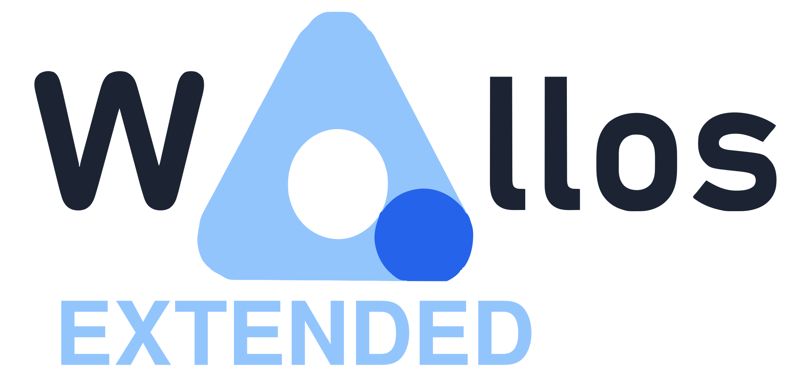

<div align="center">

<picture>
  <source media="(prefers-color-scheme: dark)" srcset=".github/assets/logo-dark.svg">
  
</picture>

### Alle wiederkehrenden Kosten deines Haushalts an einem Ort

Abos · Verträge · Versicherungen · Finanzierungen · Verbrauch · Fristen

[](https://github.com/tim247/wallos-extended/releases)
[](https://github.com/tim247/wallos-extended/pkgs/container/wallos-extended)
[](#-proxmox-lxc)
[](LICENSE.md)

[Funktionen](#-funktionen) · [Installation](#-installation) · [Handbuch](docs/HILFE.md) · [Lizenz](#-lizenz--herkunft)

</div>

---

**Wallos Extended** erweitert den beliebten Abo-Tracker [Wallos](https://github.com/ellite/Wallos)
zu einem kompletten **Haushaltsbuch für Fixkosten**. Neben Abonnements verwaltest du Verträge mit
Kündigungsfristen, Versicherungen, Kredite und Bausparverträge sowie Zählerstände – und siehst auf
einen Blick, was dein Haushalt jeden Monat wirklich kostet.

Selbst gehostet, ohne Cloud, ohne Tracking. Deine Daten bleiben auf deinem Server.

## ✨ Funktionen

<table>
<tr>
<td width="50%" valign="top">

### 📊 Dashboard & Statistik
- Monatliche **Gesamtbelastung** über alle Bereiche
- Aufteilung nach Bereich, Kategorie, Zahler, Zahlungsmethode
- 12-Monats-Trend, Preisentwicklung, Prognose
- Nächste Zahlungen und Fristen auf einen Blick
- **Preiserhöhungen** automatisch erkannt – auch angekündigte mit Stichtag –, mit Hinweis aufs Sonderkündigungsrecht
- **Jahres-Check** (behalten, vergleichen, kündigen) und Ansicht **pro Person**
- **Kostenbericht** mit Aufteilung je Person – drucken oder als PDF

</td>
<td width="50%" valign="top">

### 📄 Verträge & Versicherungen
- Erstlaufzeit, Verlängerung, Kündigungsfrist – Versicherungen auch *nur Wechsel* (Krankenkasse) oder *nicht kündbar*
- **Erinnerung** rechtzeitig vor dem letzten Kündigungstag, **Kündigungsschreiben als PDF**
- Filter, Suche (auch nach Person) und farbige Personen-Tags
- **Schadensfälle** mit Bilanz (Beiträge gegen Leistungen), „melden oder selbst zahlen?“
- Kombi-Policen, versicherte Personen, Absicherungs- und **Vorsorge-Check** (BU, Risikoleben)
- Beitragsentwicklung gegen Inflation, **Steuer-Export**, Daten aus der Police lesen

</td>
</tr>
<tr>
<td valign="top">

### 🏦 Finanzierungen
- Annuitäten- und endfällige Darlehen, **Bausparverträge**
- Tilgungsplan, Sondertilgungen, Restschuld-Diagramm, **Sondertilgung simulieren**
- Sondertilgungsrecht im Blick, geplante Ratenänderungen, Übersicht aller Kredite
- **Abgleich mit dem Kontoauszug** der Bank
- Ablösung durch einen Bausparvertrag zum Laufzeitende, Abschlussgebühr
- Hinweis 12 Monate vor Ende der Zinsbindung

</td>
<td valign="top">

### ⚡ Verbrauch
- Zähler für Strom, Gas, Wasser, **PV-Erzeugung und -Einspeisung**
- Jahresvergleich, Kosten pro Tag/Monat, **witterungsbereinigt** (Gradtage), Haushaltsvergleich
- Ungewöhnlich hoher Verbrauch (Leck?), Grundlast, Abschlag-Empfehlung
- **Abrechnung prüfen**, Tarifwechsel mit Datum, Erinnerung zum Wechsel
- Eigenverbrauch, Autarkie und **Amortisation** der PV-Anlage
- **Home Assistant**: Zählerstände täglich automatisch

</td>
</tr>
<tr>
<td valign="top">

### 🗂️ Paperless-ngx
- Verträge und Policen direkt mit Dokumenten verknüpfen
- Suche und **automatische Vorschläge** (Korrespondent, Tag, Vertragsnummer)
- Vorschau und Download ohne Paperless-Login
- Ohne Paperless: **Dokumente direkt hochladen** (PDF, Bilder, Office)

</td>
<td valign="top">

### 📅 Planung
- **Jahresübersicht**: in welchem Monat fällt was an?
- Vorschlag für die **monatliche Rücklage**
- Kalender mit allen Zahlungen, **iCal-Feed** für Outlook/Google/Apple
- Benachrichtigungen per E-Mail, Push, Telegram, ntfy, Gotify, Discord …
- **Kontoabgleich**: Kontoauszug (CSV) gegen erfasste Kosten – findet Vergessenes
- **Home Assistant**: Fixkosten und nächste Frist als Sensor, Erinnerungen aufs Handy

</td>
</tr>
<tr>
<td valign="top">

### 💶 Budget & Rückblick
- **Einnahmen & Rücklagen**: Lohn, Kindergeld … gegen alle Kosten
- Budgetplan mit Anteil am Einkommen, variable Ausgaben, Sparziele
- **Kontoverlauf** im Monat, Ausblick (wann wird was frei?), Was-wäre-wenn
- Aufteilung im Haushalt nach Einkommen
- **Jahresrückblick** im Wrapped-Stil: gespart, gekündigt, freigeschaufelte Zeit

</td>
<td valign="top">

### 🏠 Haushalt & Vorsorge
- **Fristen & Wartung**: Ausweise, Führerschein, TÜV, Heizung, Filter …
- **Inventar** mit Neu- und Zeitwert, Standorten, Kaufbelegen und **Garantie**
- **Notfall-Dossier** mit Kontakten, Verfügungen, Konten, digitalem Nachlass und Checkliste für Angehörige
- **Inaktivitäts-Wächter** mit bis zu zwei Vertrauenspersonen (eine mit eingeschränkter Sicht)
- Lese-Zugang für Partner oder Steuerberater

</td>
</tr>
</table>

Außerdem: als **App installierbar**, Testphasen-Erinnerung für Abos, Suche direkt auf dem Dashboard, Schnellerfassung fürs Handy mit Zählerstand-Prognose,
CSV-Import und -Export, Änderungsprotokoll, automatische und externe Sicherung (WebDAV),
Systemstatus und eine REST-API.

Dazu alles, was Wallos selbst mitbringt: Abonnements mit Logos, mehrere Währungen, Haushaltsmitglieder,
Ordner, Massenaktionen, Budget, Mehrbenutzer, OIDC/SSO, Zwei-Faktor-Anmeldung, API und 29 Sprachen.

## 🚀 Installation

### 🐳 Docker

```yaml
# docker-compose.yaml
services:
  wallos:
    image: ghcr.io/tim247/wallos-extended:latest
    container_name: wallos-extended
    ports:
      - "8282:80"
    environment:
      TZ: Europe/Berlin
    volumes:
      - ./db:/var/www/html/db
      - ./logos:/var/www/html/images/uploads/logos
    restart: unless-stopped
```

```bash
docker compose up -d
```

Danach `http://<server>:8282` öffnen und den ersten Benutzer registrieren (er wird Administrator).
Das Image gibt es für **amd64** und **arm64** (z. B. Raspberry Pi).

<details>
<summary>Selbst bauen</summary>

```bash
git clone https://github.com/tim247/wallos-extended.git
cd wallos-extended
docker build -t wallos-extended .
```

</details>

### 📦 Proxmox LXC

Auf dem **Proxmox-Host** als root – legt einen Debian-12-Container an und installiert alles
(nginx, PHP, Cron), ganz ohne Docker:

```bash
bash -c "$(curl -fsSL https://github.com/tim247/wallos-extended/releases/latest/download/create-lxc.sh)"
```

Wie bei den [community-scripts](https://community-scripts.org) führen Dialoge durch die Einrichtung:
**Standard** oder **Erweitert** (Container-ID, CPU, RAM, Speicher, feste IP, Datenübernahme).

**Update:** im Container einfach `update` eingeben – sichert die Datenbank und installiert die neueste Version.
Meldet die Shell `update: command not found`, das Skript direkt starten:

```bash
bash /usr/local/bin/update
```

Fehlt der Befehl ganz (Installationen vor `v5.11.1-ext.2`), einmalig einrichten und starten:

```bash
curl -fsSL https://github.com/tim247/wallos-extended/releases/latest/download/update.sh -o /usr/local/bin/update && chmod 755 /usr/local/bin/update && bash /usr/local/bin/update
```

Ohne Dialoge, z. B. für Automatisierung:

```bash
MODE=default CTID=120 IP=192.168.1.50/24 GATEWAY=192.168.1.1 STORAGE=local-zfs \
  bash -c "$(curl -fsSL https://github.com/tim247/wallos-extended/releases/latest/download/create-lxc.sh)"
```

Alle Optionen, Datenübernahme und Updates: [lxc/README.md](lxc/README.md).

### 🔄 Von Wallos umsteigen

*Admin → Sicherung und Wiederherstellung → Wiederherstellen* nimmt eine Wallos-Sicherung (`.zip`)
oder direkt die Datei `wallos.db` – aus jeder Wallos-Version, auch 5.x. Die Datenbank wird automatisch aktualisiert.

Jede Nacht sichert Wallos Extended die Datenbank zusätzlich selbst nach `db/backups/` (einstellbar unter *Admin*).

## 📖 Dokumentation

- **[Handbuch](docs/HILFE.md)** – alle Bereiche, E-Mail, Home Assistant, Paperless-ngx, Budgetplanung, Haushalt & Vorsorge, Fehlersuche
- [Umgebungsvariablen & OIDC](docs/UPSTREAM-README.md) – aus der Original-Dokumentation von Wallos
- In der App: *Menü → Hilfe*

## 🛠️ Technik

PHP 8.3 · SQLite · nginx · Vanilla JS · ApexCharts – keine externen Dienste nötig.

## ⚖️ Lizenz & Herkunft

Wallos Extended ist ein Fork von **[Wallos](https://github.com/ellite/Wallos)** von
[henrique.pt](https://henrique.pt) und den Wallos-Mitwirkenden – vielen Dank für die großartige Grundlage!

Wie das Original steht Wallos Extended unter der **[GNU General Public License v3.0](LICENSE.md)**.
Du darfst es nutzen, verändern und weitergeben, solange abgeleitete Werke ebenfalls unter der GPL-3.0
stehen und der Quellcode verfügbar bleibt. Welche Änderungen gegenüber dem Original gemacht wurden,
steht in der [NOTICE](NOTICE.md).

Wallos Extended ist ein unabhängiges Projekt und **nicht mit dem Original-Wallos verbunden**.
Bitte melde Fehler hier und nicht beim Original-Projekt.
