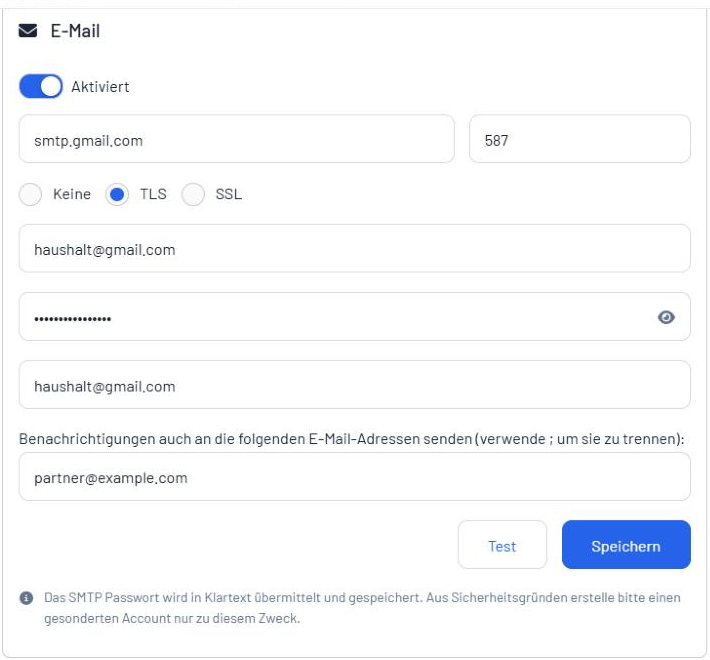
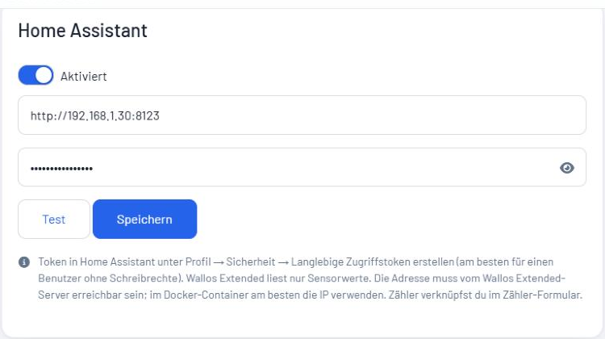
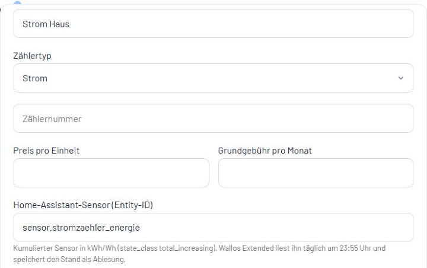
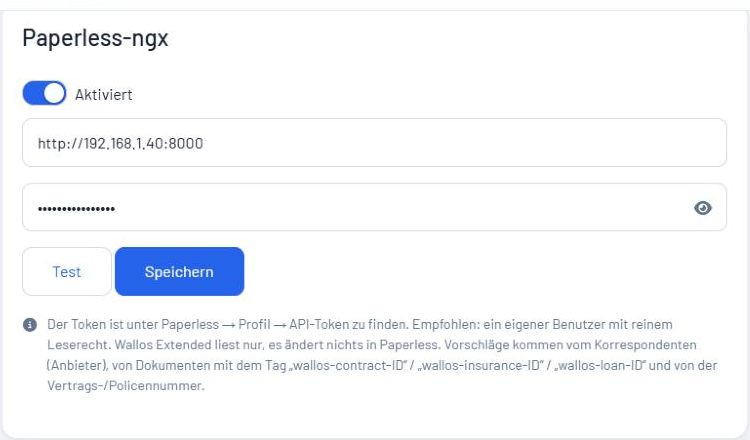

# Wallos Extended – Handbuch

Dieses Handbuch erklärt die Einrichtung und alle Bereiche von Wallos Extended, mit
Schritt-für-Schritt-Anleitungen für **E-Mail**, **Home Assistant** und **Paperless-ngx**.
Eine Kurzfassung gibt es in der App selbst unter *Menü → Hilfe*.

## Inhalt

1. [Erste Schritte](#1-erste-schritte)
2. [Die Bereiche im Überblick](#2-die-bereiche-im-überblick)
3. [E-Mail einrichten](#3-e-mail-einrichten)
4. [Home Assistant anbinden](#4-home-assistant-anbinden)
5. [Paperless-ngx anbinden](#5-paperless-ngx-anbinden)
6. [Weitere Benachrichtigungen](#6-weitere-benachrichtigungen)
7. [Sicherung und Wiederherstellung](#7-sicherung-und-wiederherstellung)
8. [Automatische Aufgaben](#8-automatische-aufgaben)
   - [Weitere Werkzeuge](#8a-weitere-werkzeuge) · [Haushalt & Vorsorge](#8b-haushalt--vorsorge)
9. [Fehlersuche](#9-fehlersuche)

---

## 1. Erste Schritte

1. **Installieren** – mit Docker oder als Proxmox-LXC-Container, siehe [README](../README.md#installation).
2. **Ersten Benutzer registrieren** – beim ersten Aufruf öffnet sich die Registrierung. Der erste
   Benutzer wird automatisch **Administrator**.
3. **Grundeinstellungen** unter *Einstellungen*:
   - **Haushalt**: alle Personen anlegen, die etwas bezahlen (für Aufteilung und Benachrichtigungen).
   - **Währungen**: Hauptwährung prüfen; für Fremdwährungen einen Fixer-API-Key eintragen.
   - **Kategorien** und **Zahlungsmethoden** anpassen.
4. **Server-Adresse** unter *Admin → Server-URL* eintragen (z. B. `https://wallos.example.com`),
   damit Links in E-Mails (Passwort zurücksetzen, E-Mail bestätigen) funktionieren.

> [!TIP]
> Wallos Extended läuft auch ohne Internet. Nur Wechselkurse, Logo-Suche, Push und externe
> Benachrichtigungsdienste brauchen eine Verbindung nach außen.

---

## 2. Die Bereiche im Überblick

| Bereich | Wofür | Besonderheiten |
|---|---|---|
| **Dashboard** | Monatliche Gesamtbelastung, nächste Zahlungen und Fristen | Suche ganz oben, Kacheln führen in den jeweiligen Bereich, Hinweise (Budget, fehlende Versicherungen, Systemstatus) |
| **Abonnements** | Streaming, Software, Mitgliedschaften … | Preisverlauf, Archiv, mehrere Kategorien/Zahler, Massenaktionen, „bezahlt“ markieren |
| **Verträge** | Strom, Internet, Handy, Fitnessstudio … | Mindestlaufzeit, Verlängerung, Kündigungsfrist, Kündigungsschreiben als PDF |
| **Versicherungen** | Haftpflicht, Hausrat, Kfz … | wie Verträge, mit Versicherungsnummer |
| **Finanzierungen** | Darlehen, Bausparverträge | Tilgungsplan, Sondertilgungen, Zinsbindung, Abgleich mit Kontoauszug, Ablösung durch Bausparvertrag |
| **Verbrauch** | Strom, Gas, Wasser, PV-Einspeisung | Zählerstände, Diagramme, Abschlag vs. Verbrauch, Home-Assistant-Import |
| **Kalender** | alle Zahlungen eines Monats | iCal-Link für Outlook/Google/Apple |
| **Jahresübersicht** | jährliche Beiträge je Monat | Vorschlag für die monatliche Rücklage |
| **Statistiken** | Auswertungen | Abschnitt „Haushalt“ über alle Bereiche |
| **Kostenbericht** | alle laufenden Kosten auf einer Seite | Aufteilung nach Person, Preisänderungen, als PDF speichern |
| **Kontoabgleich** | Kontoauszug (CSV) gegen erfasste Kosten | findet Preisänderungen und nicht erfasste Abbuchungen |
| **Einnahmen & Rücklagen** | Budgetplanung: Einnahmen gegen alle Kosten | Budgetplan, Kontoverlauf, Ausblick, Aufteilung im Haushalt, Was-wäre-wenn |
| **Jahresrückblick** | dein Jahr als Karten | gespart, gekündigt, günstiger geworden, teuerstes Hobby, freigeschaufelte Zeit |
| **Fristen & Wartung** | Ausweise, Führerschein, Impfungen, TÜV, Heizung, Filter … | Erinnerung vorher, „Erledigt“ plant den nächsten Termin |
| **Inventar** | was steht wo, was ist es wert | Neuwert und Zeitwert, Standorte, Kaufbelege, Warnung bei Unterversicherung |
| **Notfall-Dossier** | alles für Angehörige im Notfall | drucken, verschlüsselt exportieren, Inaktivitäts-Wächter |

Das Menü ist in Gruppen geordnet: *Übersicht*, *Laufende Kosten*, *Planung*, *Haushalt & Vorsorge*,
*Erfassen & Werkzeuge* und *Konto*.

### Kündigungsschreiben

Bei Verträgen und Versicherungen öffnet *Kündigungsschreiben* einen Dialog: Absender, Empfänger
und Kündigungsdatum eintragen (leer = nächstmöglicher Zeitpunkt), *PDF erzeugen*. Danach den
Status auf **Verschickt** und nach der Bestätigung des Anbieters auf **Bestätigt** setzen –
ab „Verschickt“ hören die Fristerinnerungen auf. Den Text der Vorlage ändert der Admin unter
*Admin → Kündigungsvorlage*. Verfügbare Platzhalter: `{{absender_name}}`, `{{absender_adresse}}`,
`{{anbieter}}`, `{{bezeichnung}}`, `{{nummer}}`, `{{nummer_info}}`, `{{kuendigung_zum}}`, `{{frist}}`,
`{{datum}}`, `{{ort}}`. Die Vorschau zeigt das Ergebnis als PDF.

### Preiserhöhungen

Jede Preisänderung eines Abos, Vertrags oder einer Versicherung wird automatisch protokolliert –
egal ob du den Preis von Hand änderst oder eine angekündigte Preisänderung greift. Erhöhungen der
letzten 12 Monate zeigt das Dashboard im Panel **Preiserhöhungen** mit altem und neuem Preis und
Prozent. Bei Verträgen und Versicherungen steht dazu der Hinweis *Sonderkündigungsrecht prüfen*:
Erhöht ein Anbieter einseitig den Preis, darfst du meist außerordentlich kündigen – das
Kündigungsschreiben ist einen Klick entfernt.

### Tarifvergleich (Strom, Gas, Wasser)

Unter *Verbrauch* bei einem Zähler *Zählerstand erfassen* aufklappen, dann *Tarifvergleich*.
Grundlage ist dein Jahresverbrauch: die letzten 12 Monate, wenn die Zählerstände so weit
zurückreichen, sonst die Hochrechnung für dieses Jahr. Trage Arbeitspreis, monatliche
Grundgebühr und einen einmaligen Bonus des neuen Angebots ein – sofort steht da, was der neue
Tarif im Jahr kostet und wie viel du sparst oder mehr zahlst. Bei Gas mit Umrechnungsfaktor wird
in kWh gerechnet.

### Eigene Dokumente (ohne Paperless)

Bei Verträgen, Versicherungen und Finanzierungen gibt es im Bearbeiten-Dialog den Abschnitt
**Eigene Dokumente**. Dort lädst du Vertrag, Police oder Kontoauszug direkt hoch: PDF, Bilder
(PNG, JPG, WebP, GIF), Text, Word, Excel, OpenDocument und E-Mails (`.eml`, `.msg`), je Datei
bis 20 MB. Ein Klick auf den Namen öffnet PDFs und Bilder im Browser, andere Dateien werden
heruntergeladen.

Die Dateien liegen im Ordner `db/files` (also im selben Volume wie die Datenbank), sind von außen
nicht abrufbar und in der Sicherung (*Admin → Sichern*) enthalten. Wird ein Eintrag gelöscht,
werden seine Dateien mit gelöscht.

### Kostenbericht

*Menü → Kostenbericht* zeigt alle laufenden Kosten auf einer Seite: Summe pro Monat und Jahr,
die **Aufteilung nach Person** (aus dem Zahler der Einträge; Einträge ohne Zahler stehen unter
„Gemeinsam“), jede Position nach Bereich und die Preisänderungen der letzten 12 Monate.
*Drucken / PDF* öffnet den Druckdialog des Browsers – mit **Als PDF speichern** entsteht ein PDF,
z. B. für die Steuererklärung, das Gespräch mit der Bank oder die Haushaltsplanung zu zweit.
Menü und Schaltflächen werden beim Drucken ausgeblendet.

### Kontoabgleich mit dem Kontoauszug

*Menü → Kontoabgleich* vergleicht einen Kontoauszug mit deinen erfassten Kosten.

1. Im Online-Banking die Umsätze als **CSV** exportieren, am besten die letzten 2–3 Monate.
   Getestet ist das Format der Sparkassen; DKB, ING, comdirect, Volksbank, Postbank und N26
   werden ebenso erkannt (Trennzeichen, Kopfzeile, Spalten und Zeichensatz werden selbst ermittelt).
2. Datei auswählen, *Abgleichen*.

Das Ergebnis hat drei Teile:

| Abschnitt | Bedeutung | Was tun |
|---|---|---|
| **Gefunden** | Abbuchung passt zu einem Eintrag; gelb, wenn der Betrag mehr als 2 % abweicht | gelbe Zeilen: Preis anpassen (wird als Preiserhöhung protokolliert) |
| **Regelmäßig, aber nicht erfasst** | mindestens zwei Abbuchungen an denselben Empfänger mit etwa gleichem Betrag | als Abo oder Vertrag anlegen – oder ignorieren (z. B. Miete, Sparplan) |
| **Keine Abbuchung gefunden** | zu diesem Eintrag gibt es im Zeitraum keine Buchung | bei jährlichen Zahlungen normal; sonst den Anbieter so eintragen, wie er auf dem Auszug steht |

Zugeordnet wird über den **Namen und den Anbieter** eines Eintrags (Wörter ab 4 Buchstaben), die
im Empfänger oder Verwendungszweck vorkommen müssen. Heißt dein Vertrag „Handy“, die Abbuchung aber
„Vodafone GmbH“, trage *Vodafone* als Anbieter ein.

> [!NOTE]
> Die Datei wird nur gelesen und **nicht gespeichert** – weder die Buchungen noch die Datei selbst.

### Finanzierung: Abgleich mit dem Kontoauszug

Weicht der berechnete Restsaldo vom Jahreskontoauszug der Bank ab (Rundung, taggenaue Zinsen),
trage unter *Abgleich mit Kontoauszug* den Saldo laut Bank mit Datum ein. Ab diesem Datum rechnet
der Plan mit dem echten Wert weiter. Einzelne abweichende Raten lassen sich ebenfalls überschreiben.

---

## 3. E-Mail einrichten

Wallos Extended verschickt E-Mails an **zwei Stellen**, die getrennt eingerichtet werden:

| Wo | Wofür | Wer |
|---|---|---|
| *Admin → SMTP-Einstellungen* | System-Mails: Passwort zurücksetzen, E-Mail bestätigen | nur Administrator |
| *Einstellungen → Benachrichtigungen → E-Mail* | Erinnerungen an Zahlungen, Kündigungsfristen, Zinsbindung, Ablesen | jeder Benutzer |

Beide Formulare haben dieselben Felder:



| Feld | Bedeutung |
|---|---|
| SMTP-Adresse | Postausgangsserver des Anbieters |
| Port | meist `587` (mit **TLS**) oder `465` (mit **SSL**) |
| Verschlüsselung | `TLS` = STARTTLS auf Port 587, `SSL` = Port 465, `Keine` nur im Heimnetz |
| Benutzername | meist die vollständige E-Mail-Adresse |
| Passwort | bei Gmail, iCloud, Outlook ein **App-Passwort**, nicht das normale Passwort |
| Absender-E-Mail | sollte zum Konto passen, sonst lehnen viele Server ab |
| Weitere Empfänger | zusätzliche Adressen, mit `;` getrennt |

Nach dem Eintragen **Test** drücken – es kommt sofort eine Test-Mail.

### Beispiele

| Anbieter | SMTP-Adresse | Port | Verschlüsselung | Hinweise |
|---|---|---|---|---|
| Gmail | `smtp.gmail.com` | 587 | TLS | Zwei-Faktor-Anmeldung aktivieren, dann unter *Google-Konto → Sicherheit → App-Passwörter* ein Passwort erzeugen |
| GMX | `mail.gmx.net` | 587 | TLS | In den GMX-Einstellungen *POP3/IMAP-Abruf* bzw. *Versand über externe Programme* erlauben |
| WEB.DE | `smtp.web.de` | 587 | TLS | wie GMX freischalten |
| T-Online | `securesmtp.t-online.de` | 587 | TLS | eigenes *E-Mail-Passwort* im Kundencenter anlegen |
| iCloud | `smtp.mail.me.com` | 587 | TLS | App-spezifisches Passwort unter *appleid.apple.com* |
| Outlook.com | `smtp-mail.outlook.com` | 587 | TLS | Microsoft schränkt SMTP mit Passwort für private Konten zunehmend ein; ggf. anderen Anbieter verwenden |
| IONOS | `smtp.ionos.de` | 587 | TLS | |
| Strato | `smtp.strato.de` | 465 | SSL | |
| eigener Server / Mailcow | `mail.example.com` | 587 | TLS | |
| Relay im Heimnetz (z. B. Postfix) | `192.168.1.10` | 25 | Keine | nur im eigenen Netz |

> [!WARNING]
> Das SMTP-Passwort wird in der Datenbank gespeichert. Lege am besten ein **eigenes
> Postfach nur für Wallos Extended** an oder nutze ein App-Passwort, das du jederzeit widerrufen kannst.

> [!NOTE]
> Ein SMTP-Server im eigenen Netz (z. B. `192.168.1.10`) wird aus Sicherheitsgründen zunächst
> blockiert. Der Admin gibt ihn unter *Admin → Sicherheitseinstellungen* in der Freigabeliste frei
> (z. B. `192.168.1.10` oder `192.168.1.10:25`); danach funktioniert er für alle Benutzer.

---

## 4. Home Assistant anbinden

Wallos Extended liest einmal täglich die **Zählerstände** aus Home Assistant und speichert sie als
Ablesung – z. B. Stromverbrauch und PV-Einspeisung. Es liest nur, es schaltet und ändert nichts.

### Schritt 1: Token in Home Assistant erzeugen

1. In Home Assistant links unten auf deinen **Benutzernamen** klicken → Reiter **Sicherheit**.
2. Ganz unten bei **Langlebige Zugriffstoken** auf *Token erstellen*, Name z. B. `Wallos Extended`.
3. Den angezeigten Token kopieren – er wird nur einmal angezeigt.

> [!TIP]
> Am sichersten ist ein eigener Home-Assistant-Benutzer ohne Administratorrechte nur für
> Wallos Extended (*Einstellungen → Personen → Person hinzufügen*, „Darf sich anmelden“).

### Schritt 2: Verbindung in Wallos Extended eintragen

*Einstellungen → Home Assistant*:



| Feld | Beispiel |
|---|---|
| Aktiviert | an |
| Adresse | `http://192.168.1.30:8123` oder `https://ha.example.com` |
| Token | der Token aus Schritt 1 |

Dann **Test** – bei Erfolg erscheint „Verbindung OK“. Anschließend **Speichern**.

**Welche Adresse?**

- Läuft Wallos Extended in **Docker** oder im **LXC-Container**, funktioniert `homeassistant.local`
  dort meist nicht. Nimm die **IP-Adresse** von Home Assistant.
- Laufen beide auf demselben Docker-Host, geht auch die IP des Hosts mit dem HA-Port.
- Über einen Reverse Proxy: die öffentliche `https://`-Adresse.
- Private Adressen (192.168.x.x, 10.x.x.x) darf nur der Administrator eintragen.

### Schritt 3: Sensor einem Zähler zuordnen

*Verbrauch → Zähler hinzufügen* (oder bestehenden Zähler bearbeiten), Feld **Home-Assistant-Sensor**:



Geeignet sind **fortlaufend steigende Energiezähler** (`state_class: total_increasing` oder
`total`) in **Wh, kWh oder MWh** – Wh wird automatisch in kWh umgerechnet.

| Zähler in Wallos Extended | Typische Entität in Home Assistant |
|---|---|
| Strom (Bezug) | `sensor.stromzaehler_energie`, `sensor.shelly_3em_total_energy`, `sensor.tibber_pulse_accumulated_consumption`, `sensor.smart_meter_bezug` |
| PV-Einspeisung (Zählertyp „PV-Einspeisung“) | `sensor.smart_meter_einspeisung`, `sensor.wechselrichter_total_export` |

> [!IMPORTANT]
> Keine Tageszähler verwenden (z. B. `utility_meter` mit täglichem Reset oder „Energie heute“).
> Wallos Extended braucht den **Gesamtstand**, sonst entstehen falsche Verbräuche.

Die Entitäts-ID findest du in Home Assistant unter *Entwicklerwerkzeuge → Zustände* oder in den
Einstellungen der Entität (Zahnrad → *Entitäts-ID*).

### So läuft der Import

- **Automatisch** jeden Tag um **23:55 Uhr** (Cronjob `importhomeassistant`), ein Wert pro Tag.
- **Sofort** über das Symbol am Zähler (*Stand aus Home Assistant holen*).
- Ist der Sensor gerade `unavailable` oder `unknown`, wird nichts gespeichert und der nächste Lauf versucht es erneut.

### Verbindung von Hand prüfen

Vom Server, auf dem Wallos Extended läuft (z. B. `docker exec -it wallos-extended sh`):

```bash
curl -s -H "Authorization: Bearer DEIN_TOKEN" http://192.168.1.30:8123/api/
# erwartet: {"message":"API running."}

curl -s -H "Authorization: Bearer DEIN_TOKEN" \
  http://192.168.1.30:8123/api/states/sensor.stromzaehler_energie
# erwartet: "state": "12345.67" und "unit_of_measurement": "kWh"
```

### Erinnerungen als Home-Assistant-Benachrichtigung

Unter *Einstellungen → Home Assistant* den **Benachrichtigungsdienst** eintragen, z. B.
`mobile_app_pixel_7` für `notify.mobile_app_pixel_7`. Den Namen findest du in Home Assistant unter
*Entwicklerwerkzeuge → Aktionen*, wenn du `notify.` eintippst. *Test* schickt eine Probenachricht.

Danach kommen die Erinnerungen von Wallos Extended (Fristen, Kündigungen, Preiserhöhungen, Budgets,
Wächter …) einmal täglich gebündelt als eine Nachricht. Ein eigener Benachrichtigungskanal unter
*Benachrichtigungen* ist dafür nicht nötig.

### Kosten in Home Assistant anzeigen

Umgekehrt kann Home Assistant die Kosten aus Wallos Extended abfragen – z. B. für eine Karte
„Fixkosten“ im Dashboard oder eine Automation, die vor einer Kündigungsfrist erinnert.

1. In Wallos Extended unter *Profil* den **API-Schlüssel** kopieren.
2. In der `configuration.yaml` von Home Assistant einen REST-Sensor anlegen:

```yaml
rest:
  - resource: http://192.168.1.20:8282/api/summary/get_summary.php
    headers:
      X-API-Key: !secret wallos_api_key
    scan_interval: 3600
    sensor:
      - name: "Fixkosten pro Monat"
        value_template: "{{ value_json.monthly_total }}"
        unit_of_measurement: "€"
        device_class: monetary
        json_attributes:
          - monthly
          - yearly_total
          - count
          - price_increases_12m
      - name: "Nächste Kündigungsfrist"
        value_template: "{{ value_json.next_deadline.date if value_json.next_deadline else 'unknown' }}"
        device_class: date
        json_attributes_path: "$.next_deadline"
        json_attributes:
          - name
          - days
      - name: "Nächste Abo-Zahlung"
        value_template: "{{ value_json.next_payment.date if value_json.next_payment else 'unknown' }}"
        device_class: date
        json_attributes_path: "$.next_payment"
        json_attributes:
          - name
          - amount
```

und in der `secrets.yaml`: `wallos_api_key: DEIN_API_SCHLÜSSEL`. Danach Home Assistant neu starten.

Die Antwort von `get_summary.php` sieht so aus:

```json
{
  "success": true,
  "currency": "EUR",
  "monthly_total": 714.15,
  "yearly_total": 8569.8,
  "monthly": {"subscription": 15.99, "contract": 34.9, "insurance": 4.92, "loan": 658.34, "meter": 0},
  "count": 5,
  "price_increases_12m": 1,
  "next_payment": {"name": "Netflix", "date": "2026-12-01", "amount": 15.99},
  "next_deadline": {"name": "Fitnessstudio", "date": "2027-06-01", "days": 199}
}
```

`monthly.meter` sind die monatlichen Abschläge der Zähler. Der Schlüssel kann statt im Header auch
als `?api_key=…` übergeben werden – der Header ist sicherer, weil er nicht in Logdateien landet.

Beispiel-Automation: drei Wochen vor einer Kündigungsfrist aufs Handy.

```yaml
automation:
  - alias: "Kündigungsfrist naht"
    trigger:
      - platform: template
        value_template: "{{ state_attr('sensor.nachste_kundigungsfrist', 'days') == 21 }}"
    action:
      - service: notify.mobile_app_mein_handy
        data:
          message: >
            In 3 Wochen endet die Kündigungsfrist für
            {{ state_attr('sensor.nachste_kundigungsfrist', 'name') }}.
```

---

## 5. Paperless-ngx anbinden

Deine Dokumente bleiben in Paperless-ngx. Wallos Extended zeigt bei Verträgen, Versicherungen und
Finanzierungen die passenden Dokumente an, schlägt neue vor und öffnet sie direkt – ohne dass du
dich in Paperless anmelden musst. Es liest nur, es ändert nichts in Paperless.

### Schritt 1: API-Token in Paperless erzeugen

1. In Paperless-ngx rechts oben auf den **Benutzer** → **Mein Profil**.
2. Bei **API-Authentifizierungs-Token** auf das Erneuern-Symbol klicken und den Token kopieren.

> [!TIP]
> Empfohlen ist ein eigener Paperless-Benutzer mit **nur Leserechten** (*Einstellungen →
> Benutzer & Gruppen*, Berechtigungen „Anzeigen“ für Dokumente, Korrespondenten und Tags). Wallos
> Extended sieht dann nur, was dieser Benutzer sehen darf.

### Schritt 2: Verbindung eintragen

*Einstellungen → Paperless-ngx*:



| Feld | Beispiel |
|---|---|
| Aktiviert | an |
| Adresse | `http://192.168.1.40:8000` oder `https://paperless.example.com` |
| Token | der Token aus Schritt 1 |

**Test** prüft Adresse und Token, dann **Speichern**. Für die Adresse gilt dasselbe wie bei Home
Assistant: im Container die IP verwenden, private Adressen nur als Administrator.

### Schritt 3: Dokumente verknüpfen

Öffne einen Vertrag, eine Versicherung oder eine Finanzierung. Im Bereich **Dokumente** kannst du

- **suchen** (in Titel und Inhalt) und ein Dokument mit einem Klick verknüpfen,
- **Vorschläge** übernehmen,
- verknüpfte Dokumente als **Vorschau** öffnen oder **herunterladen**,
- eine Verknüpfung wieder lösen (das Dokument in Paperless bleibt unverändert).

### Wie die Vorschläge entstehen

Wallos Extended schlägt Dokumente vor, wenn

1. der **Korrespondent** in Paperless zum Anbieter passt (z. B. Korrespondent „Allianz“ bei der
   Versicherung mit Anbieter „Allianz“),
2. ein Dokument das passende **Tag** trägt, z. B. `wallos-contract-3` – den genauen Tag-Namen
   zeigt der Bereich *Dokumente* unten an,
3. die **Vertrags- bzw. Versicherungsnummer** im Text des Dokuments vorkommt.

> [!TIP]
> Am zuverlässigsten: In Paperless die Korrespondenten so benennen wie die Anbieter in Wallos
> Extended. Dann erscheinen neue Briefe automatisch als Vorschlag.

### Verbindung von Hand prüfen

```bash
curl -s -H "Authorization: Token DEIN_TOKEN" \
  "http://192.168.1.40:8000/api/documents/?page_size=1"
# erwartet: {"count": ..., "results": [...]}
```

Achtung: Paperless erwartet `Token`, Home Assistant `Bearer`.

---

## 6. Weitere Benachrichtigungen

Unter *Einstellungen → Benachrichtigungen* gibt es außer E-Mail u. a. **Push-Benachrichtigungen**
im Browser bzw. auf dem Handy, **Telegram**, **ntfy**, **Gotify**, **Pushover**, **Discord**,
**Mattermost** und **Webhooks**. Unter *Benachrichtigungen* stellst du auch ein, wie viele Tage
vorher erinnert wird.

Wallos Extended erinnert an

- fällige Zahlungen von Abonnements,
- Kündigungsfristen von Verträgen und Versicherungen (einmal pro Frist),
- das Ende der Zinsbindung einer Finanzierung (12 Monate vorher),
- überfällige Zählerablesungen (Intervall je Zähler einstellbar),
- Preiserhöhungen (einmal je Erhöhung),
- Fristen & Wartungen (Ausweise, TÜV, Heizung … – Vorlauf je Eintrag einstellbar),
- ablaufende Garantien und Belegfristen (30 Tage vorher),
- überschrittene Kategorie-Budgets (höchstens einmal pro Kategorie und Monat),
- den Inaktivitäts-Wächter (14, 7, 3, 2 und 1 Tag vor dem Versand an die Vertrauensperson),
- den Jahresabschluss (erste Januarwoche),
- für den Administrator: eine fehlende nächtliche Sicherung.

Alle diese Erinnerungen außer den Abo-Zahlungen kommen auf Wunsch zusätzlich als
**Home-Assistant-Benachrichtigung** aufs Handy, siehe Kapitel 4.

---

## 7. Sicherung und Wiederherstellung

*Admin → Sicherung und Wiederherstellung*:

- **Sichern** lädt eine `.zip` mit Datenbank, hochgeladenen Logos und eigenen Dokumenten herunter.
- **Wiederherstellen** nimmt eine solche `.zip` **oder** eine einzelne `wallos.db` – aus jeder
  Version des Original-Wallos (auch 5.x) bzw. von Wallos Extended. Die Datei wird geprüft, die bisherige
  Datenbank bleibt als `before-restore-JJJJMMTT-HHMMSS.db` im Ordner `db` liegen, alte Datenbanken
  werden automatisch auf den aktuellen Stand gebracht. Danach wirst du abgemeldet.

Die Datenbank liegt

| Installation | Ordner |
|---|---|
| Docker (`docker-compose.yaml`) | `./db` neben der Compose-Datei |
| Docker (Ordner `docker/`) | `./data/db` |
| LXC-Container | `/var/www/wallos-extended/db` |

### Automatische Sicherung

Jede Nacht um **3:15 Uhr** wird die Datenbank nach `db/backups/wallos-JJJJMMTT-HHMMSS.db`
kopiert – konsistent, auch während die App benutzt wird. Unter *Admin → Sicherung und
Wiederherstellung → Automatische Sicherung* stellst du ein, wie viele Sicherungen aufbewahrt
werden (Standard 14, `0` schaltet sie ab); dort steht auch die letzte Sicherung.

Zum Zurückspielen die gewünschte Datei aus `db/backups/` holen (z. B. per `docker cp` oder über
die Freigabe des Volumes) und bei *Wiederherstellen* auswählen.

> [!TIP]
> Die automatischen Sicherungen liegen auf demselben Datenträger wie die Datenbank. Sie schützen
> vor Bedienfehlern und kaputten Updates, nicht vor einem defekten Datenträger. Trag deshalb unter
> *Automatische Sicherung* einen **WebDAV-Ordner** ein (Nextcloud z. B.
> `https://cloud.example.com/remote.php/dav/files/BENUTZER/Backups`, am besten mit einem
> App-Passwort): Jede nächtliche Sicherung wird dann zusätzlich dorthin kopiert. Eigene Dokumente
> (`db/files`) gehen dabei nicht mit – die sichert *Sichern* (ZIP).

### Systemstatus

*Admin → Systemstatus* zeigt Version, Größe der Datenbank, freien Speicher, die letzte Sicherung
und wann jede Hintergrundaufgabe zuletzt gelaufen ist (mit der letzten Log-Zeile). Rot markiert:
keine Sicherung in den letzten zwei Tagen bzw. eine Aufgabe, die seit über einer Woche nicht lief.

### Eigene Daten exportieren

*Kostenbericht → ZIP* lädt alle eigenen Daten herunter: eine CSV pro Tabelle (Abos, Verträge,
Versicherungen, Kredite, Zähler, Zählerstände, Preis-Historie, Änderungsprotokoll …) und die
hochgeladenen Dokumente. *CSV* liefert nur die Kostenübersicht für Excel.

### Umstieg vom Original-Wallos

Eine `wallos.db` oder Sicherung aus dem Original-Wallos lässt sich in jeder Version einspielen.
Bei Datenbanken ab Wallos 5 werden die Migrationsnummern beim Einspielen automatisch umgesetzt
(im Original heißen sie 000047 ff., in Wallos Extended 000101 ff.), danach werden die
Erweiterungen (Verträge, Versicherungen …) ergänzt.

---

## 8. Automatische Aufgaben

Diese Aufgaben laufen im Hintergrund (in Docker und im LXC-Container bereits eingerichtet):

| Aufgabe | Wann |
|---|---|
| Nächste Zahlungstermine weiterschieben | täglich |
| Wechselkurse aktualisieren | täglich |
| Benachrichtigungen und Kündigungserinnerungen | täglich |
| Home-Assistant-Import | täglich 23:55 Uhr |
| Automatische Sicherung der Datenbank | täglich 3:15 Uhr |
| Inaktivitäts-Wächter (Versand an die Vertrauensperson) | täglich 10:00 Uhr |
| Nach neuen Versionen suchen | alle 6 Stunden |

Ob alles läuft, zeigt *Admin → Systemstatus*. Fehlt die nächtliche Sicherung oder haben die
Hintergrundaufgaben seit zwei Tagen nichts mehr geschrieben, erscheint auf dem Dashboard des
Administrators ein Hinweis; die fehlende Sicherung wird zusätzlich gemeldet.

---

## 8a. Weitere Werkzeuge

- **Suche** (oben auf dem Dashboard): durchsucht Namen, Anbieter, Vertrags- und Policennummern,
  Notizen, Fristen, Inventar und Dateinamen der eigenen Dokumente. Die Treffer klappen beim Tippen
  auf, gruppiert nach Bereich. `/` springt ins Suchfeld, ↑/↓ wählen, Enter öffnet, Esc schließt;
  *Alle Treffer anzeigen* führt zur vollständigen Liste.
- **Schnellerfassung** (Menü, fürs Handy): Zählerstand in drei Feldern eintragen oder einen Beleg
  direkt mit der Kamera fotografieren und einem Vertrag, einer Versicherung oder einem Kredit
  zuordnen.
- **Prognose beim Zählerstand** (Verbrauch und Schnellerfassung): Aus dem bisherigen Verbrauch
  steht der erwartete Stand grau im Feld. Leer lassen oder die ersten Ziffern tippen und speichern
  übernimmt die Prognose; Tab oder → schreibt sie ins Feld. Wer etwas anderes tippt, speichert genau
  das. Beim Haken *Zählerwechsel* gibt es keinen Vorschlag.
- **CSV-Import** (Menü): Abos, Verträge und Versicherungen aus Excel übernehmen. Die Seite zeigt
  die Spalten und bietet eine Vorlage. Fehlerhafte Zeilen werden übersprungen und angezeigt.
- **Änderungsprotokoll** (Menü): wann wurde was angelegt, geändert (mit altem und neuem Wert)
  oder gelöscht.
- **Lese-Link** (unten im Kostenbericht): ein geheimer Link auf den Kostenbericht, ohne Anmeldung
  und nur zum Lesen – z. B. für Partner oder Steuerberater. *Widerrufen* macht ihn sofort ungültig.
- **Erste Schritte** (Dashboard): erscheint bei neuen Konten, bis Haushalt, Benachrichtigung und
  die ersten Kosten eingerichtet sind.
- **Einnahmen & Rücklagen** (Menü) – die Budgetplanung:
  - **Einnahmen** wie Gehalt, Kindergeld oder Mieteinnahmen, mit Zahltag, Person und optionalem
    Enddatum (z. B. wenn das Kindergeld endet).
  - **Variable Ausgaben** als Monatsbudget für alles ohne festen Vertrag: Lebensmittel, Tanken,
    Kleidung, Freizeit.
  - **Sparziele** mit Zielbetrag und Zieldatum; die Seite rechnet aus, wie viel pro Monat nötig ist.
  - **Budgetplan**: Einnahmen oben, darunter Versicherungen, Kredite, Verträge, Abos, Verbrauch,
    variable Ausgaben und Rücklagen – jeweils mit Anteil am Einkommen – und was frei bleibt.
  - **Kontoverlauf**: der Kontostand über den aktuellen Monat mit dem tiefsten Punkt. Einnahmen
    kommen am Zahltag, Fixkosten an ihren Terminen, variable Ausgaben werden verteilt. Den
    Kontostand am 1. eintragen, um zu sehen, ob es vor dem Gehalt eng wird.
  - **Ausblick**: wann Einnahmen enden, Kredite abbezahlt sind oder befristete Verträge auslaufen
    – und wie viel danach pro Monat frei ist.
  - **Aufteilung im Haushalt**: wer verdient was, wer zahlt was, und der faire Anteil an allen
    Kosten im Verhältnis der Einnahmen.
  - **Was wäre wenn?**: Einnahmen, Kreditraten, Kosten oder Rücklagen probeweise ändern, ohne zu
    speichern – z. B. für Teilzeit oder eine Umschuldung.

  Sobald Einnahmen erfasst sind, zeigt das Dashboard die Kachel *frei verfügbar*.
- **Jahresrückblick** (Menü → Planung): dein Jahr als Karten – wie viel du durch Kündigungen und
  günstigere Preise pro Jahr sparst, was gekündigt wurde, was teurer wurde, dein teuerstes „Hobby“
  (die Kategorie mit den höchsten Kosten) und die freigeschaufelte Zeit. Die Zeit ist eine Schätzung
  mit offen angezeigten Annahmen (2 Std. je Kündigung, 5 Min. je automatischem Zählerstand, 30 Min.
  je erledigter Frist). Im Januar zeigt die Seite das Vorjahr, ältere Jahre lassen sich auswählen.
  Gezählt wird, was in Wallos erfasst ist – gekündigte Einträge also archivieren statt löschen.
- **Belegfristen**: Bei jedem eigenen Dokument (Verträge, Versicherungen, Kredite) lässt sich ein
  Ablaufdatum eintragen, z. B. das Ende der Garantie. 30 Tage vorher kommt eine Benachrichtigung.
- **Jahresabschluss**: In der ersten Januarwoche kommt eine Benachrichtigung mit den laufenden
  Kosten des Vorjahres, dem steuerlich absetzbaren Anteil und der Zahl der Preiserhöhungen.

## 8b. Haushalt & Vorsorge

### Fristen & Wartung

Für alles, was wiederkehrt, aber nicht monatlich abgebucht wird. Zwei Bereiche:

- **Ausweise & Dokumente**: Personalausweis, Reisepass, Führerschein, Impfungen, Gesundheitskarte.
- **Wartung & Prüfungen**: TÜV/HU, Inspektion, Ölwechsel, Gasprüfung (z. B. Wohnwagen), Heizung,
  Filterwechsel, Rauchmelder, Schornsteinfeger.

Je Eintrag: für wen bzw. welches Fahrzeug, gültig bis / nächster Termin, Intervall in Monaten
(wird bei der Kategorie vorgeschlagen) und wie viele Tage vorher erinnert wird. Überfällige
Termine sind rot, bald fällige orange; fällige stehen auch auf dem Dashboard unter *Demnächst*.
**Erledigt** merkt sich den Tag und plant den nächsten Termin ab heute.

### Inventar

Gegenstände mit Kategorie, **Standort** (z. B. Keller, Garage, Wohnwagen), Kaufdatum, Kaufpreis
(= Neuwert), Nutzungsdauer und Seriennummer; Kaufbelege lassen sich direkt anhängen. Die Seite
zeigt **Neuwert** und **Zeitwert** (lineare Abschreibung über die Nutzungsdauer), auch je Standort,
mit Filter. Ist bei einer Hausratversicherung eine Versicherungssumme eingetragen und liegt der
Neuwert darüber, warnt sie vor Unterversicherung.

### Notfall-Dossier

Alles, was Partner oder Angehörige im Notfall brauchen: Versicherungen, Verträge, Kredite, Abos,
Konten, Zähler und Ausweise – mit Anbieter, Nummer, Adresse, Zahlung und Kündigungsfrist – plus
deine **Notfall-Hinweise** (Ansprechpartner, wo Unterlagen liegen, was zuerst zu tun ist; keine
Passwörter, lieber auf den Notfallzugang des Passwort-Managers verweisen).

- **Drucken / PDF** für den Ordner.
- **Verschlüsselt exportieren**: eine HTML-Datei, die sich offline in jedem Browser mit einem
  Passwort öffnet (AES-256, Schlüssel per PBKDF2 mit 600.000 Runden). Die Verschlüsselung passiert
  im Browser, das Passwort erreicht den Server nie. Das funktioniert nur über **HTTPS oder
  localhost** – sonst *Drucken / PDF* verwenden. Das Passwort getrennt aufbewahren.

### Inaktivitäts-Wächter

Im Notfall-Dossier unter *Inaktivitäts-Wächter*: Meldest du dich eine bestimmte Zeit lang
(30, 60, 90, 180 oder 365 Tage) nicht an, bekommt deine **Vertrauensperson** eine E-Mail mit einem
persönlichen Link zum Notfall-Dossier und deiner Nachricht.

1. Vorher erinnert Wallos Extended dich 14, 7, 3, 2 und 1 Tag vor Ablauf. Einmal anmelden genügt.
2. Der Link öffnet das Dossier erst mit dem **Zugangscode** (mind. 8 Zeichen), den du der
   Vertrauensperson **persönlich oder auf Papier** gibst – eine weitergeleitete E-Mail allein reicht
   nicht. Nach 10 falschen Codes ist der Link gesperrt, nach 30 Tagen läuft er ab.
3. Meldest du dich danach wieder an (z. B. nach einem langen Urlaub), wird der Link sofort ungültig.

Voraussetzungen: *Admin → Server-URL* ist eingetragen und E-Mail-Versand ist eingerichtet (SMTP in
der Verwaltung oder bei den E-Mail-Benachrichtigungen). Fehlt etwas, steht ein Hinweis im Wächter.
Anmeldungen über einen Lese-Zugang zählen nicht als Lebenszeichen.

### Lese-Zugang

*Einstellungen → Lese-Zugang* legt eine eigene Anmeldung an (Benutzername und Passwort, mind. 10
Zeichen) – für Partner, Familie oder Steuerberater. Wer sich damit anmeldet, sieht alle deiner
Daten (Dashboard mit Suche, Bereiche, Kalender, Kostenbericht, Einnahmen, Jahresrückblick, Fristen,
Inventar, Notfall-Dossier, Änderungsprotokoll), kann
aber nichts anlegen, ändern oder löschen. Einstellungen, Profil, Verwaltung, Import und
Schnellerfassung bleiben gesperrt, ebenso der API-Schlüssel. Oben steht *Nur lesen*.
Löschen des Zugangs sperrt ihn sofort; wird dein Konto gelöscht, verschwinden auch seine
Lese-Zugänge.

> [!NOTE]
> Der **Lese-Link** im Kostenbericht ist die einfachere Variante ohne Anmeldung: nur der Bericht,
> für jeden mit dem Link. Der Lese-Zugang zeigt mehr, braucht aber ein Passwort.

### API

Mit dem API-Schlüssel aus *Profil* (Parameter `api_key` oder Header `X-API-Key`):

| Endpunkt | Zweck |
|---|---|
| `GET api/summary/get_summary.php` | Summen für Home Assistant (siehe Kapitel 4) |
| `GET api/finance/get_items.php?type=…` | Daten lesen: `contracts`, `insurances`, `loans`, `meters`, `readings` (optional `meter_id`), `price_history`, `audit_log`; `archived=1` zeigt auch Archiviertes |
| `POST api/finance/add_reading.php` | Zählerstand eintragen: `meter_id`, `reading_value`, optional `reading_date` (JJJJ-MM-TT, Standard heute) und `note` |

Beispiel für n8n oder ein Skript:

```bash
curl -X POST -H "X-API-Key: DEIN_SCHLUESSEL" -H "Content-Type: application/json" \
  -d '{"meter_id": 1, "reading_value": 12345.6}' \
  https://wallos.example.com/api/finance/add_reading.php
```

Die Abo-Endpunkte des Original-Wallos (`api/subscriptions/…`) gibt es weiterhin.

### Ereignisse an andere Systeme

Preiserhöhungen, Kündigungsfristen, Zinsbindungsende, fällige Zählerstände und überschrittene
Kategorie-Budgets laufen über die Kündigungs-Benachrichtigungen – also auch über den
**Webhook**-Kanal (*Einstellungen → Benachrichtigungen → Webhook*, Feld für Kündigungen ausfüllen).
Damit lassen sich n8n, Node-RED oder Home Assistant automatisieren. Ein Budget meldet sich höchstens
einmal pro Kategorie und Monat.

---

## 9. Fehlersuche

| Problem | Lösung |
|---|---|
| Test-Mail kommt nicht an | Port und Verschlüsselung prüfen (587/TLS oder 465/SSL), App-Passwort verwenden, Spam-Ordner ansehen |
| „Diese Adresse ist nicht erlaubt“ | Home Assistant / Paperless: private IPs darf nur der Admin eintragen; `169.254.x.x` ist immer gesperrt |
| E-Mail an Server im Heimnetz scheitert | IP in *Admin → Sicherheitseinstellungen* freigeben |
| Home Assistant: „Verbindung fehlgeschlagen“ | Adresse vom Container aus erreichbar? (`curl` siehe oben); `homeassistant.local` durch IP ersetzen |
| Home Assistant: Sensor „nicht verfügbar“ | Entitäts-ID prüfen, Sensor liefert eine Zahl? Einheit Wh/kWh? |
| Kontoabgleich: „keine Buchungen gefunden“ | Export als CSV (nicht PDF/MT940/CAMT) wählen; die Datei braucht eine Kopfzeile mit Datum und Betrag |
| Kontoabgleich ordnet nichts zu | Anbieter beim Eintrag so eintragen, wie er auf dem Kontoauszug steht |
| Home-Assistant-Sensor „Fixkosten“ bleibt leer | API-Schlüssel im Profil prüfen; `curl -H "X-API-Key: …" http://SERVER:8282/api/summary/get_summary.php` |
| Paperless: 401/403 | Token neu erzeugen; Benutzer braucht Leserechte auf Dokumente, Korrespondenten und Tags |
| Paperless: keine Vorschläge | Korrespondent wie den Anbieter benennen oder Tag `wallos-contract-ID` vergeben |
| Diagramme leer | Diagramme erscheinen, sobald genug Daten vorhanden sind (z. B. mindestens zwei Ablesungen) |
| Nach Update alte Ansicht | Seite neu laden (Strg+F5), der Browser hat Dateien zwischengespeichert |
